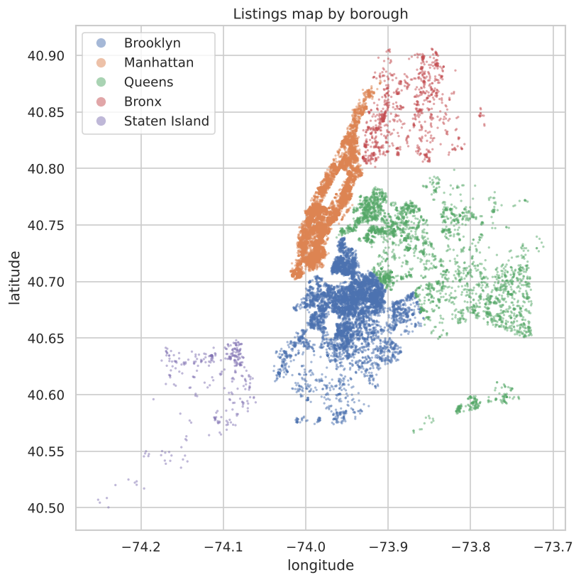
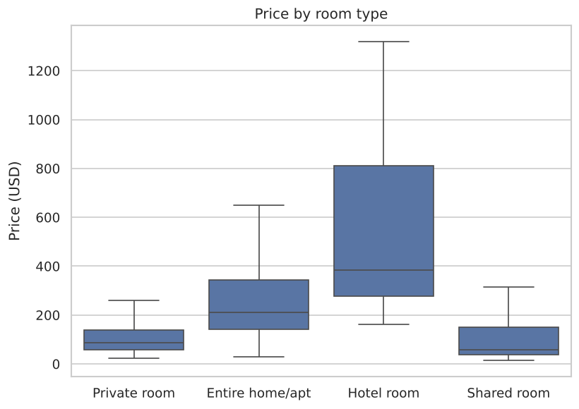
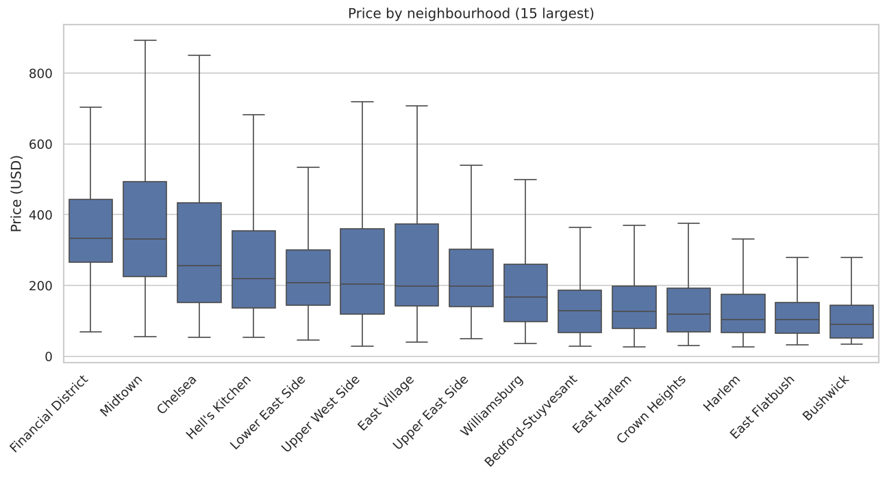
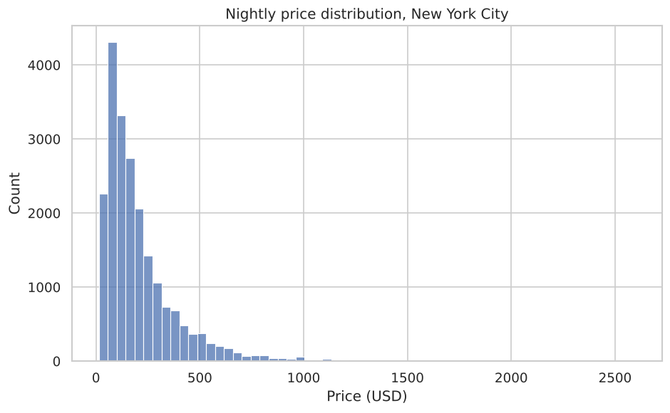

# 🗽 Airbnb NYC: Data Cleaning & Exploratory Analysis

Data analysis project in **Python / pandas** on ~36,000 Airbnb listings in New York City
([Inside Airbnb](https://insideairbnb.com/get-the-data/), June 2025 snapshot).
The project covers the full analysis workflow: data loading, cleaning, outlier handling,
feature engineering, visual EDA, hypothesis checks and an executive summary.

Data Analysis course project at Ruppin Academic Center.

## 🔍 Key Findings
| | |
|---|---|
| Listings after cleaning | **21,214** (of 36,322) |
| Median nightly price | **$152** (mean $219) |
| Entire home vs. private room | **2.4×** more expensive ($210 vs $86 median) |
| Most expensive borough | **Manhattan** ($222 median), Bronx cheapest ($90) |
| 30+ night minimum stay | **81%** of listings (effect of NYC Local Law 18) |
| No review in 2 years | **39%** of listings |
| Reviews vs. availability | Spearman ρ = −0.18: more-reviewed listings are booked more |

## 📊 Visualizations
| | |
|---|---|
|  |  |
|  |  |

## 🧹 Analysis Pipeline
1. **City selection**: `src/select_city.py` sums the digits of the team members' IDs, takes `% 26` → letter **N** → New York City
2. **Load & inspect**: dtypes, descriptive stats, unique values, missing-value table
3. **Cleaning**: type conversion, duplicates, listings without price dropped, impossible values (price ≤ 0, minimum nights outside 1–365)
4. **Outliers**: Z-score on log(price), |z| > 3 removed
5. **Feature engineering**: `price_category` (tertiles), `reviews_intensity`, `is_long_min_stay`, `is_multi_host`, `inactive_2y`
6. **EDA**: univariate and bivariate plots, borough map, inactive-listing rates
7. **Hypotheses**: room type vs. price, reviews vs. availability, multi-listing hosts, borough prices
8. **Output**: cleaned dataset + executive summary

## 🛠 Tech Stack
Python · pandas · NumPy · Matplotlib · Seaborn · Jupyter / Google Colab

## 🚀 Run It
```bash
git clone https://github.com/AdamElmalek/airbnb-nyc-data-analysis.git
cd airbnb-nyc-data-analysis
pip install -r requirements.txt
jupyter notebook notebooks/airbnb_nyc_analysis.ipynb
```
The notebook also runs in **Google Colab** (it detects Colab and uses the Drive folder).
To repeat the city selection: `python src/select_city.py <id1> <id2>`.

## 📁 Structure
```
data/
  raw/listings.csv            Inside Airbnb NYC listings (input)
  airbnb_major_cities.txt     Cities to choose from
  selected_city.txt           Output of the city selection
notebooks/
  airbnb_nyc_analysis.ipynb   Main analysis
outputs/figures/              Generated charts
src/select_city.py            City selection script
```

## 👥 Authors
- **Adam Elmalek**
- **Mohammed Younis**

Data: [Inside Airbnb](https://insideairbnb.com), licensed under [CC BY 4.0](https://creativecommons.org/licenses/by/4.0/).
